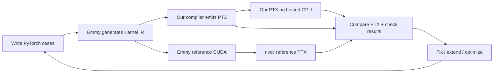
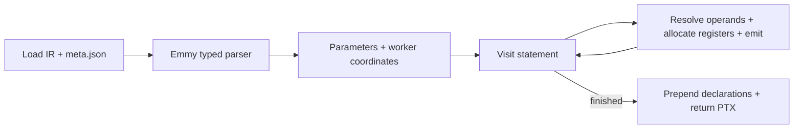

# Compiler walkthrough

We translate Emmy's scheduled Kernel IR directly into PTX, preserving operations, datatypes and synchronization.

## 1. Our development workflow



Extend the public baseline by varying **PyTorch operations, shapes, datatypes and schedules**. Keep generated IR unchanged; compare GPU results with independent NumPy and typed-IR references.

Compare against Emmy CUDA → nvcc PTX to identify optimizations. Only our PTX runs on the hosted GPU. Retain regressions and benchmark after correctness.

## 2. How the compiler runs



`load_kernel()` pairs typed IR with metadata's argument order, buffers and launch requirements. `statement()` visits operations and nested bodies; the GPU executes the emitted instructions later.

`PTXEmitter` inherits `ScalarMath` and `TensorMath`, sharing register counters, maps and instructions without an additional IR.

Code: [load_kernel](compile.py#L40), [statement](compile.py#L621), [compile](compile.py#L778).

## 3. Worked example: every IR statement → our PTX

### PyTorch and actual Emmy output

```python
x = torch.randn(128, dtype=torch.float16)
result = torch.tanh(x) * 1.5
```

**Actual pinned-Emmy output**; `Tile` is line 1:

```text
Tile[a0] (N=64)
    in1__u0 = load x[((a0 * 2) + 0)]
    f16 v0__u0 = tanh(in1__u0)
    in0__u0 = load mul_c1[0]
    f16 v1__u0 = multiply(in0__u0, v0__u0)
    in1__u1 = load x[((a0 * 2) + 1)]
    f16 v0__u1 = tanh(in1__u1)
    in0__u1 = load mul_c1[0]
    f16 v1__u1 = multiply(in0__u1, v0__u1)
    mul[((a0 * 2) + 0)] = (v1__u0, v1__u1)
```

### A. Create parameters from metadata

| `arg_order` | Buffer | Global address register |
| --- | --- | --- |
| `arg_0` | `mul_c1`: one f16 value, 1.5 | `%rd2` |
| `arg_1` | `x`: 128 f16 values | `%rd4` |
| `arg_2` | `mul`: 128 output values | `%rd6` |

The constant is a buffer. All parameters are **64-bit addresses** to 16-bit elements:

```ptx
.visible .entry k_mul_pointwise(
    .param .u64 arg_0,
    .param .u64 arg_1,
    .param .u64 arg_2
)
```

Load `x`'s pointer; the other pointers follow the same pattern:

```ptx
ld.param.u64 %rd3, [arg_1];
cvta.to.global.u64 %rd4, %rd3;
```

### B. Map the Tile to threads and byte addresses

```ptx
mov.u32 %r1, %tid.x;
mov.u32 %r2, %ctaid.x;
mov.u32 %r3, %ntid.x;
mad.lo.s32 %r4, %r2, %r3, %r1;
setp.ge.u32 %p1, %r4, 64;
@%p1 bra DONE;
```

256 threads launch; 64 workers remain active. `values["a0"] = "%r4"`; worker five handles elements ten/eleven. Tile decoding reuses this coordinate, eliminating divide-by-one and outer remainder.

IR line 2 computes element `2*a0`; f16 elements occupy two bytes:

```ptx
mul.lo.s32 %r5, %r4, 2;
add.s32 %r6, %r5, 0;
mov.s32 %r7, %r6;
mul.wide.s32 %rd7, %r7, 2;
add.u64 %rd8, %rd4, %rd7;
```

`%rd8 = x_base + (2*a0)*2`. Constant loads use index zero.

### C. Visit each body statement and bind its result

Arithmetic bindings below are **after f16 rounding**.

| IR line | Corresponding emitted PTX | `values` binding |
| --- | --- | --- |
| 2: load first `x` | `ld.global.b16 %h1, [%rd8+0];` then `cvt.f32.f16 %f1, %h1;` | `in1__u0 → %f1` |
| 3: first tanh | `tanh.approx.f32 %f3, %f1;` + half rounding | `v0__u0 → %f4` |
| 4: load constant | `ld.global.b16 %h3, [%rd10+0];` then `cvt.f32.f16 %f5, %h3;` | `in0__u0 → %f5` |
| 5: first multiply | `mul.rn.f32 %f6, %f5, %f4;` + half rounding | `v1__u0 → %f7` |
| 6: load second `x` | `ld.global.b16 %h5, [%rd12+0];` then `cvt.f32.f16 %f8, %h5;` | `in1__u1 → %f8` |
| 7: second tanh | `tanh.approx.f32 %f10, %f8;` + half rounding | `v0__u1 → %f11` |
| 8: load constant again | `ld.global.b16 %h7, [%rd14+0];` then `cvt.f32.f16 %f12, %h7;` | `in0__u1 → %f12` |
| 9: second multiply | `mul.rn.f32 %f13, %f12, %f11;` + half rounding | `v1__u1 → %f14` |
| 10: grouped Write | Convert `%f7`/`%f14` to half bits, then `st.global.v2.b16` | Store both results |

`value_dtypes` records **f16** despite `%f` working registers. `pointers` holds buffer bases. `reg(kind)` increments `counts[kind]` for fresh names.

### D. Expand a math operation and preserve rounding

`arithmetic()` calls `ptx_math.py`'s `activation()`, then `round_half()`. IR line 3 becomes:

```ptx
tanh.approx.f32 %f3, %f1;
cvt.rn.f16.f32 %h2, %f3;
cvt.f32.f16 %f4, %h2;
```

Our helper emits **native PTX sequences**. Round to half, then widen: multiplication receives the half-rounded intermediate. The same rounding pattern produces `%f7` after line 5.

### E. Optimize the store and finalize declarations

```ptx
cvt.rn.f16.f32 %h9, %f7;
cvt.rn.f16.f32 %h10, %f14;
st.global.v2.b16 [%rd16], {%h9, %h10};
```

`%rd16 = output_base + 4*a0`. Proved four-byte alignment allows one paired store. `vector_store()` retains scalar fallback when alignment is unknown.

After emitting the body, counters produce the header declarations:

```ptx
.reg .b32 %r<16>;
.reg .b64 %rd<17>;
.reg .f32 %f<15>;
.reg .b16 %h<11>;
.reg .pred %p<2>;
```

Counters start at one; declarations include zero. Gaps such as `%f2` are unused reserved names. **ptxas allocates physical registers**: this hosted kernel used 14. We implement no liveness pass.

Code: [reg](compile.py#L114), [arithmetic](compile.py#L247), [activation](ptx_math.py#L11), [round_half](compile.py#L414), [address](compile.py#L457), [vector_store](compile.py#L352).

## 4. How this extends to other kernels

### Scalar math: `ptx_math.py`

| Path | Implementation and reasoning |
| --- | --- |
| f16/f32 exp/log | Native `ex2.approx` / `lg2.approx`, exp range reduction and a near-one log series |
| f64 math / floating power | Double-precision expansions and domain handling; floating power converts back for f16/f32 |
| Sigmoid / tanh | Stable exp-based formulas and a near-zero tanh polynomial; f16 tanh uses the native path shown above |
| Integer power | Exponentiation by squaring for nonnegative exponents |

Math approximations are tested; helper FMA does not fuse arbitrary IR operations. Code: [floating_math](ptx_math.py#L249).

### Reductions and fused operations

For `torch.randn(64, 512).sum(-1)`, 128 workers form partial sums, then cooperate:

| Actual IR operation | Emission |
| --- | --- |
| `for a1 in a1_co..512:128` | Runtime counter, comparison, branch and stride increment |
| `WarpShuffle(acc0, length=32)` | `shfl.sync.bfly.b32` plus the merge program |
| `Sync` + `TreeHalve` | Barrier and shared-memory reduction of four warp partials |

Accumulators carry state; loops preserve scope. Extensions include RMSNorm, L2 normalization and online softmax's coupled maximum/sum merge. Code: [counted_loop](compile.py#L524), [merge_states](compile.py#L489).

### Tensor cores: `ptx_tensor.py`

For f16 `a @ b`, the staged path follows:

```text
CpAsyncCopy → shared memory → LdmatrixLoad → MmaSyncPtx → RegStore
```

`fragments[name]` tracks role, dtype and registers. Per thread: four packed A registers, two B and four f32 C; native m16n8k16 `mma.sync` computes cooperatively across the warp.

The helper handles lane layouts, swizzles and guarded stores; the visitor preserves commit/wait/barrier order. Extensions include split-K, transposed B, multiple warps and buffering.

Code: [fragment allocation](ptx_tensor.py#L93), [matrix_load](ptx_tensor.py#L107), [mma_sync](ptx_tensor.py#L162), [reg_store](ptx_tensor.py#L172).

## 5. Evidence, reproduction and future work

**Worked example: passes both references. MVP: 8/8.** Matmul suites passed 9 global + 9 shared cases; public normalization, softmax and scalar 512×512 matmul also pass.

[Fresh hidden-style MVP variants](docs/compiler/19-mvp-hidden-coverage.md): 71/71 GPU results match IR, 62/71 match NumPy. Nine expression/precision disagreements and five Emmy generation failures remain recorded; hidden completeness is unproven.

```bash
python tools/generate_walkthrough_example.py --runner
python tools/test_mvp.py
```

[Actual IR](tests/walkthrough/tanh_scale_f16_128/k_mul_pointwise.ir.txt) · [Full emitted PTX](tests/walkthrough/tanh_scale_f16_128/k_mul_pointwise.ours.ptx) · [Per-statement emission trace and GPU result](review/walkthrough/tanh-scale-emission.json).

Future work: atomic accumulation for m02, larger fragment families and epilogues, end-to-end attention, and further optimization guided by correctness checks and measured performance.
