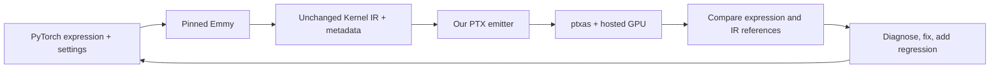

# Compiler presentation walkthrough

This walkthrough explains our approach, PTX generation, implementation categories, worked examples, coverage and future work. All examples and explanations are included here. Source links are optional references.

Implementation checkpoint: **60cad9e**. The exact eight MVP problems passed through unchanged `submit.py --compiler compile.py`. Compiler sources remain unchanged while this document is edited.

## Workflow and approach

1. **Naive baseline:** start with the supplied add/reduction examples and implement their actual typed statement kinds. Never identify a problem by name inside the compiler or hardcode its output.
2. **Generate extensions at the source level:** write PyTorch expressions and change shapes, datatypes and Emmy schedule knobs before tracing. Examples include width 1, irregular widths 33/129, different cooperative sizes, boolean compositions and matmul K tails.
3. **Pin the producer:** Emmy 0.3.11 emits the IR. `emmy_fixtures.py` compares the packaged payload with the original dump, allowing only the organizer's entry-name normalization, and writes a provenance/hash proof. No body/type/shape/schedule rewriting is permitted.
4. **Keep two references:** independent NumPy expression expectations, plus a bounded NumPy interpreter of the supplied typed IR. A GPU/IR match does not erase an original-expression failure.
5. **Compile and run our output:** `compile.py` emits PTX; local ptxas checks assembly; the hosted runner checks actual GPU output using the original metadata. Only our compiler's PTX is uploaded.
6. **Diagnose before optimizing:** distinguish producer rejection, unsupported compiler nodes, assembly failure, execution failure, expression mismatch and IR-reference mismatch. Fix the relevant layer and retain regression evidence.
7. **Inspect and measure:** examine PTX/SASS, physical register counts and spills. Benchmark only after correctness, keep paired samples, and distinguish historical measurements from the frozen implementation.
8. **Commit validated increments:** source, genuine examples, results and explanations are checked into the compiler repository. The current implementation is frozen while preparing the presentation.

If pinned Emmy cannot generate a particular source/schedule, that attempted case is out of scope. Trying a valid alternative PyTorch spelling or correcting a schedule knob is allowed; manufacturing replacement IR is not. Earlier synthetic fixtures are retired and excluded from active coverage totals.



### Generating extended cases

The first baseline was add, then increasingly complex pointwise and reduction programs. We expanded the **source generator**, not the serialized IR. For example, the existing operation generator can build this family:

```python
x = torch.randn(3, 129, dtype=torch.float32)
y = torch.randn(3, 129, dtype=torch.float32)
result = ((x - y) / (y*y + 1)).sum(-1)
```

Changing the generator's size, dtype or WORK setting regenerates the source and asks Emmy to produce a new real schedule. It does not rename an axis, force a different accumulator dtype or replace a reduction combiner inside a parsed kernel.

The fixture contains:

| File | Purpose |
| --- | --- |
| expression.py | Human-readable PyTorch source/settings |
| `<entry>.ir.json` | Machine-readable Emmy Kernel IR consumed by our compiler |
| `<entry>.ir.txt` | Emmy's readable listing of the same program |
| meta.json | Argument order, shapes/types, input initializers, launch, shared bytes and output initialization |
| expected.npz | Original expression results calculated independently with NumPy |
| emmy-proof.json | Producer/package versions, source/settings and hashes proving that fresh packaged IR matches the dump |
| `<entry>.ours.ptx` | Output produced by our own compiler |

The organizer's input metadata seeds NumPy generators for runtime input arrays. Those exact arrays, cast to the declared dtype, are also used for the expression expectation. Explicit numerical edge patterns are represented in the PyTorch setup and matched to runtime metadata. They do not justify changing the IR. Some generators additionally compare the NumPy expression with eager CPU PyTorch.

For a floating reduction, an expression reference may accumulate in double and then round to the requested output dtype. Operation-level rounding is retained for composed half expressions. Integer comparisons are exact rather than checked with a loose floating tolerance. A wide-integer comparison test constructs adjacent values near 2^60 **inside the kernel** and returns small values, avoiding ambiguity from large-number serialization in the hosted API.

For the composed-sum expression above, the independent NumPy calculation is equivalent to the generator's implementation:

```python
one = np.asarray(1, dtype=x.dtype)
values = (x - y) / (y*y + one)
expected = values.astype(np.float64).sum(-1).astype(x.dtype)
```

With three input rows, the expected result has three elements. The packager names each expected array using the actual graph output names and saves them in expected.npz. The runner reconstructs the same input arrays from metadata, and the checker compares its returned output at the fixture's declared tolerance. Neither Emmy's CUDA execution nor our interpreter supplies that original expression expectation.

The provenance wrapper makes this concrete. After applying only the organizer's required kernel-entry naming normalization, it compares the packaged graph with the original Emmy dump:

```python
if json.loads(packaged.read_text()) != upstream:
    raise ValueError("Packaged IR differs from Emmy output beyond entry-name normalization")
```

It then records the packaged and original dump hashes. Strict reuse verifies them. Legacy genuine fixtures without fresh proof are not given fabricated retrospective proof; they must be regenerated for strict reuse. Retired synthetic cases are excluded from active totals.

### The feedback loop

For every applicable case, we keep both the original expression expectation and the independent typed-IR expectation:

| Observation | What we investigate |
| --- | --- |
| Emmy cannot generate/package the case | Record an upstream rejection for that exact source/schedule; do not fabricate IR |
| Our compiler rejects a node Emmy generated | A real compiler coverage gap |
| ptxas rejects the emitted text | Instruction syntax, types, target availability or allocation problem |
| GPU differs from both expectations | Inspect addressing, launch interpretation, state, arithmetic and synchronization |
| GPU matches typed IR but not original expression | Inspect explicit IR precision/order choices; retain the expression failure |
| GPU matches the original expression but not the interpreter | Inspect both our emission and the test interpreter; neither reference is assumed infallible |
| Both comparisons pass | This generated case passes at its stated tolerance; this is not a proof about every hidden case |

Two actual feedback examples are useful to explain aloud if asked:

- Raw `tanh.approx.f32` produced about 0.76160097 for tanh(1), versus about 0.76159418 expected. We retained the strict f32 tolerance and replaced that path with a more accurate exp-based expansion. Half kept the native tanh path because its tests passed.
- A staged scalar matmul matched the original expected array on the GPU while the interpreter returned zeros. The checker had discarded mutable accumulator updates across an outer loop. We fixed checker state handling; we did not overwrite the original expected array or change the kernel.

Known f64 expression differences are handled separately. For example, the generated tanh-sum kernel computes f64 tanh but explicitly accumulates and merges in f32 before copying to f64. Matching those instructions does not make it an original-expression pass. That distinction remains in the reports.

## High-level overview of PTX generation

### Terminology and stage ownership

| Term | Meaning in this project |
| --- | --- |
| PyTorch expression | The source program used to generate extended cases, such as `x.sum(-1)` or `a @ b` |
| Emmy | The upstream compiler that traces/schedules the source and produces the input IR |
| Kernel IR | The already scheduled typed program our compiler must translate: loads, assignments, loops, barriers, fragments and copies |
| Tile | A logical iteration space mapped onto GPU workers; its element count is not automatically the input length or block size |
| PTX | NVIDIA's virtual GPU instruction language; this is our compiler's output |
| ptxas / driver compilation | The downstream stage that turns PTX into target machine code and allocates physical registers |
| SASS | The machine instructions inspected in local disassembly |
| Warp / block | A warp contains 32 lanes; a block contains one or more cooperating warps with shared memory/barriers |
| Fixture | Source, IR, metadata, expectations and provenance stored together for one reproducible case |
| Oracle | An independent reference result used to check execution |

The compilation path is **Kernel IR → our direct PTX emitter → PTX**. We do not reconstruct PyTorch at submission time, add a new lowering IR, call nvcc, invoke cuBLAS or use an external compiler to translate the input. Emmy's earlier Tile/Loop passes already chose the schedule; our job is to implement it faithfully.

The **test-generation** path is different: **PyTorch → pinned Emmy → fixture**. The generator asks Emmy for its CUDA-stage dump so the organizer's packager can extract launch information and the earlier Kernel IR. The reference CUDA file it produces is not our translation path and is never uploaded as our implementation.

We emit PTX targeting sm_89. The hosted runner executes compatible PTX on its RTX 5090/sm_120 target. Target instruction availability still matters: using an instruction merely because the runner is newer does not make it legal for our declared sm_89 program.

### Loading the program and emitting its entry

The key loader statement in compile.py is:

```python
graph = Graph.from_dict(json.loads(ir_path.read_text(encoding="utf-8")))
```

This uses Emmy's parser to reconstruct real typed objects. We do not manually interpret a pretty-printed body string. `load_kernel()` requires one KernelOp and matches its entry name to one descriptor in the sibling meta.json. The graph node's identifier and the executable entry name are separate concepts.

The metadata contract is:

| Field | Meaning |
| --- | --- |
| entry / kernel.name | Executable entry name emitted in `.visible .entry` |
| arg_order | Positional argument order; reordering it changes the ABI |
| args | Buffer names, element types and shapes used for loads, stores and address calculations |
| grid / block | Prescribed launch geometry; the runner launches it and the compiler validates its supported forms |
| smem_bytes | Dynamic shared-memory budget supplied at launch |
| zero_outputs | Buffers the runner must initialize before executing the graph |

For each argument, the emitter declares a u64 pointer parameter. These are actual lines from p00's emitted output:

```ptx
.version 8.0
.target sm_89
.address_size 64
```

```ptx
ld.param.u64 %rd1, [arg_0];
cvta.to.global.u64 %rd2, %rd1;
```

The u64 is the **address**, not the element datatype. An f32 tensor has four-byte elements reached through a 64-bit global pointer. Loop/index registers can be 32-bit without making global addresses 32-bit. Some shared-state addresses are narrowed to u32 for instructions whose address operand requires that form.

The emitter generates the body before printing register declarations, so it knows how many virtual registers it allocated. Its state includes value-name bindings, value datatypes, argument pointers, shared-buffer shapes/addresses, alignment facts and fragment-register tuples. `statement()` selects the correct handler from the actual node class. Unsupported forms raise a diagnostic instead of producing plausible but unsupported PTX.

Our register names are virtual names. `%f`, `%d`, `%l`, `%r`, `%rd`, `%h` and `%p` distinguish working banks for f32, f64, i64/packed bits, 32-bit integers, pointers, half storage bits and predicates. ptxas allocates physical registers afterward. We did not implement a physical register allocator or liveness pass.

## Category 1 — pointwise operations

The source is `torch.randn(128) + torch.randn(128)`. Its actual readable Kernel IR is:

```text
Tile[a0] (N=64)
    in0__u0 = load x0[((a0 * 2) + 0)]
    in1__u0 = load x1[((a0 * 2) + 0)]
    f32 v0__u0 = add(in0__u0, in1__u0)
    in0__u1 = load x0[((a0 * 2) + 1)]
    in1__u1 = load x1[((a0 * 2) + 1)]
    f32 v0__u1 = add(in0__u1, in1__u1)
    add[((a0 * 2) + 0)] = (v0__u0, v0__u1)
```

There are 64 logical workers, each handling two elements, for 128 outputs. Metadata launches one block of 256 threads. Therefore 192 threads must exit before performing the body. **N=64 is neither the input length nor the launch block size.** These are the actual emitted guard instructions:

```ptx
mov.u32 %r1, %tid.x;
mov.u32 %r2, %ctaid.x;
mov.u32 %r3, %ntid.x;
mad.lo.s32 %r4, %r2, %r3, %r1;
setp.ge.u32 %p1, %r4, 64;
@%p1 bra DONE;
```

The global worker index is blockIdx.x*blockDim.x+threadIdx.x. `tile_coordinates()` decomposes it into the IR axes. For an ordinary pointwise Tile, the bounds check protects inactive workers. Cooperative kernels instead require complete blocks so a barrier is not reached by only part of a block.

For the first element, the emitter calculates the element index, multiplies by four bytes, adds the pointer, loads both values and performs an add. Representative lines from p00 are:

```ptx
mul.wide.s32 %rd7, %r7, 4;
add.u64 %rd8, %rd2, %rd7;
ld.global.f32 %f1, [%rd8+0];
```

```ptx
add.rn.f32 %f3, %f1, %f2;
```

The second IR assignment produces the next scalar result. Because the final Write groups two adjacent values at an aligned starting index, the emitter ends with:

```ptx
st.global.v2.f32 [%rd16], {%f3, %f6};
```

This is two scalar additions followed by one vector **memory store**, not one special two-element add instruction. Emmy already unrolled the body into two assignments; our compiler translates them rather than inventing a new vector program.

For a row-major buffer, address() flattens `[row, col]` as `row*columns+col`, then multiplies by element size. For higher ranks it repeats the same multiply-and-add construction. Scalars with one stored element also have a supported empty-index form.

### Datatypes, arithmetic and optimizations

| Tensor dtype | Memory width | Working representation |
| --- | --- | --- |
| f16 | 2 bytes | Exactly widened f32 value, rounded back to half at operation boundaries |
| f32 | 4 bytes | f32 register |
| f64 | 8 bytes | f64 register |
| i32 | 4 bytes | Signed 32-bit register arithmetic |
| i64 | 8 bytes | Signed 64-bit register arithmetic |
| Internal bool | No tensor-memory ABI implemented | Predicate register |

Half rounding is an explicit narrow/widen pair:

```ptx
cvt.rn.f16.f32 %h2, %f2;
cvt.f32.f16 %f3, %h2;
```

These lines show the representation pattern; they are not an additional test kernel. Rounding at the original operation boundary prevents a chain of half operations from silently becoming a full-f32 chain with only a final store conversion. Double/integer conversions use their actual source/destination widths. Integer division truncates toward zero; multiplication retains the low result bits.

The arithmetic dispatcher selects an opcode from the operation and declared dtype. This excerpt is from arithmetic():

```python
binary = {"add": "add", "subtract": "sub", "multiply": "mul", "divide": "div"}
result = self.data_reg(dtype)
if operation in binary and len(operands) == 2:
    opcode = binary[operation]
    suffix = ".lo" if integer and operation == "multiply" else "" if integer else ".rn"
    self.emit(f"{opcode}{suffix}.{kind} {result}, {operands[0]}, {operands[1]};")
```

The implemented operation families are:

| Operation | Translation/important behavior |
| --- | --- |
| add/subtract/multiply/divide | Typed native arithmetic; integer and floating rules remain distinct |
| copy | Typed move after conversion |
| negative/abs/square | Native sign/absolute instructions or multiplication |
| ReLU | Comparison and selection, retaining the emitter's zero/NaN behavior |
| maximum/minimum | Integer native extrema; floating compare/select plus explicit NaN propagation |
| sqrt/reciprocal | Separate round-to-nearest native instructions |
| rsqrt | Internal sqrt then reciprocal, with the single IR operation's final half rounding |
| integer power | Exponentiation by squaring for nonnegative exponents |
| integer bitwise AND/right shift | Width-preserving bit operations, including the 32-bit shift-count requirement |
| exp/log/power/sigmoid/tanh | Datatype-dependent native-backed or full-double expansions explained below |
| same-width 32/64-bit bitcast | Raw reinterpretation rather than numeric conversion; current end-to-end evidence is limited |

`vector_store()` allows two/four adjacent values with total width at most 16 bytes. It checks base alignment and proves that the flattened index has the needed divisor. For example, `row*8+col*4` is divisible by four; `row*5+col*4` is not guaranteed to be. Unknown alignment retains scalar stores. Four f64 values exceed our 16-byte vector limit and fall back.

The Tile helpers also replace division by a power of two with a shift, modulo by a power of two with a mask, and unit-extent coordinates with constants. They rely on the validated in-range worker coordinate. These are local emission simplifications, not a new optimization-pass pipeline. We do not infer liveness, reorder reductions or contract arbitrary multiply/add nodes into FMA.

### Boolean comparisons and where

Consider the tested source expression:

```python
result = torch.where(x > y, x, y)
```

The comparison's result type is bool, but its inputs remain numeric. The where condition remains a predicate, while only its alternatives are converted to the output dtype. Converting every argument to the assignment's result type would be incorrect for both operations.

An actual generated f32 case emits:

```ptx
setp.gt.f32 %p2, %f1, %f2;
selp.f32 %f3, %f1, %f2, %p2;
```

`selp` chooses its first value when the predicate is true, otherwise its second. The selection itself needs no branch. We support the six numeric comparisons `>`, `>=`, `<`, `<=`, `==` and `!=`, and tested AND/OR/NOT compositions of their predicates. Floating != uses an unordered comparison so NaN != anything is true; the other listed comparisons are ordered.

Integer-to-integer comparisons retain integer width. For mixed integer/floating operands, we follow Emmy's C++ comparison behavior: the floating operand can cause promotion and associated precision loss. This matters because Emmy emits an f32 scalar constant even for some integer comparisons such as `x > 0`. The checker implements the same promotion explicitly rather than assuming NumPy's default promotion rules.

Numeric where supports the five output datatypes. A bool memory/output interface, boolean-valued where and arbitrary branch joins are not part of this support.

## Category 2 — reductions

The public row sum has input shape 64×512. Its actual IR is:

```text
Tile[a0, a1_co] (N=8192)
    for a1 in a1_co..512:128
        in0 = load x[a0, a1]
        f32 acc0 <- add(acc0, in0)
    WarpShuffle(acc0, length=32)
    Smem float acc0_smem[4]
    if ((lane == 0)):
        acc0_smem[warp] = acc0
    Sync
    TreeHalve(acc0, length=4, tid=warp)
    if ((a1_co == 0)):
        sum_1[a0] = acc0
```

Each row gets 128 cooperating workers, four warps. A worker visits four columns: its starting coordinate, plus 128, 256 and 384. WarpShuffle combines each warp's partials. One lane per warp writes one of four shared slots. A barrier makes those stores visible before the shared tree combines the four warp results. One designated worker writes the row result. The total logical Tile size is 64*128=8192.

`counted_loop()` emits an index initialization, loop-head label, end comparison/branch, body, index increment and backward branch. StridedLoop uses the supplied start, step and optional bound. Ordinary Loop uses zero, step one and its static extent. Runtime loops are retained even when Emmy provides an unroll hint.

The actual two-row-sum source `x.sum(-1)+y.sum(-1)` generates a cooperative strided reduction for x followed by a sequential Loop for y. An ordinary Loop is therefore real scheduled Kernel IR, not a new reduction representation we invented.

The sequential portion of that actual generated listing is:

```text
for a2 in 0..129
    in1 = load y[a0, a2]
    f32 acc1 <- add(acc1, in1)
f32 v0 = add(acc0, acc1)
add[a0] = v0
```

`seed=True` initializes loop-owned accumulators from the operation's identity. `seed=False` updates already initialized state, as in staged matmul. A loop's index and temporary loads/assignments stay local; completed accumulator state remains available. Typed Init supplies explicit initial state, while Let supplies literals or supported pure/index bindings.

Reduction combination is separate from elementwise arithmetic: subtraction may form each value before a sum, but does not become an unordered subtraction tree. The emitter recognizes add/multiply/max/min combiner families. Producer-generated sum/mean/max programs establish active coverage; minimum/product handlers alone do not prove coverage when the pinned producer rejects their source tests.

`merge_states()` executes the supplied combine program before copying its results back into the original state registers. This avoids updating one state too early when another state still needs the old value. For 64-bit shuffle values, we shuffle two 32-bit halves and reassemble them. Shared allocation, barriers and the supplied tree shape remain explicit.

## Category 4 — fused normalization and softmax

The supported public programs include these formulas:

```text
L2:      y_i = x_i / sqrt(sum_j(x_j*x_j))
RMSNorm: y_i = x_i / sqrt(mean_j(x_j*x_j) + epsilon) * w_i
Softmax: y_i = exp(x_i - max(x)) / sum_j(exp(x_j - max(x)))
```

The compiler does not replace the kernel with these formulas or call a library. The formulas explain what the actual Load/Assign/Accum/Shuffle/Tree instructions accomplish.

The online softmax IR carries both a running maximum m and a scaled exponential sum s. When a new value x arrives, it computes a new maximum g, rescales old state and updates:

```text
g = max(m, x)
s = s*exp(m-g) + exp(x-g)
m = g
```

When partial states merge, the sum must be rescaled to the merged maximum. Adding raw partial sums without that rescaling would be wrong. We preserve Emmy's explicit rescale assignments and the Accum base argument. A second pass over the row forms the output using the final maximum and reciprocal sum.

This is why coupled-state merge ordering, literal Let values and typed math matter beyond a simple reduction. Normalization also shows why a supplied sqrt followed by reciprocal is kept as two rounded operations rather than replaced with an arbitrary approximate rsqrt.

## Extended scalar math

PTX provides useful primitives, not one native instruction for every operation and datatype. Our paths are:

| Operation | f16/f32 | f64 |
| --- | --- | --- |
| exp | Native ex2 approximation with range reduction, split constants and underflow handling | Full-double range-reduced polynomial |
| log | Native lg2 approximation with a near-one correction | Full-double exponent/mantissa decomposition and series |
| floating power | Our double log/exp expansion with domain/sign fixups, then result conversion | Same double path without narrowing |
| sigmoid | Stable formula using native-backed exp and rounded arithmetic | Same stable formula with double exp/arithmetic |
| tanh | Native tanh for f16; exp-based formula plus near-zero polynomial for f32 | Double formula and a longer near-zero polynomial |

For exp, simply computing `ex2(x*log2(e))` loses too much accuracy at large magnitudes. We instead form x=k*ln(2)+r and reconstruct exp(x) from exp(r)*2^k. Two ln(2) pieces reduce cancellation error. The f32 helper limits the normal scale exponent and handles the first nonzero subnormal transition. It does not use an ftz modifier to discard subnormals.

For log, hardware lg2's absolute error becomes large relative to a true answer close to zero. On x in [0.75,1.25], we use z=(x-1)/(x+1) and the short odd series:

```text
ln(x) ≈ 2*z*(1 + z²/3 + z⁴/5 + z⁶/7 + z⁸/9)
```

Outside that interval, the native lg2 result supplies the main path. Base conversion scales the result appropriately. These approximations are tested numerical implementations, not claims of universally correct rounding.

Sigmoid avoids overflow and cancellation with t=exp(-abs(x)):

```text
x >= 0: sigmoid(x) = 1/(1+t)
x < 0:  sigmoid(x) = t/(1+t)
```

For f32/f64 tanh away from zero, t=exp(-2*abs(x)) gives magnitude (1-t)/(1+t). Near zero, the subtraction loses precision, so we use an odd polynomial. The f32 series through degree seven is:

```text
x*(1 - x²/3 + 2*x⁴/15 - 17*x⁶/315)
```

The f64 series extends through degree fifteen. The sign-bit path preserves negative zero; ordinary tolerance-based GPU checks alone are not a bitwise signed-zero proof. Native tanh stays in the f16 path because the current half tests pass.

Floating power uses exp(y*log(abs(x))) with explicit real-domain/sign and special-case handling. Negative finite bases require integral exponents; odd exponents restore a negative sign. Integer power instead repeatedly squares the base and halves the nonnegative exponent, retaining the declared integer width. Its invalid negative-exponent domain is not claimed as supported.

## Category 3 — matmul and native tensor cores

The source below is a real generated case:

```python
a = torch.randn(16, 16, dtype=torch.float16)
b = torch.randn(16, 8, dtype=torch.float16)
result = a @ b
```

One native m16n8k16 instruction computes C=A*B+C for a 16×8 output tile and a K chunk of sixteen. **All 32 lanes cooperate on that tile.** Each lane owns four output values, not a complete independent matrix multiply.

| Fragment role | Per-lane registers | Numeric elements per lane |
| --- | --- | --- |
| A | Four packed b32 registers | Eight f16 elements |
| B | Two packed b32 registers | Four f16 elements |
| C | Four f32 registers | Four f32 accumulator elements |

RegFragment declares these registers and zero-initializes C. An unstaged LdmatrixLoad gathers half elements from global memory and packs them into those registers; it does not emit the shared-only ldmatrix instruction. MmaSyncPtx emits native MMA. RegStore maps the lane's C elements back to output coordinates and converts to the declared output dtype.

These declarations are copied from the generated shared fixture:

```text
RegFragment a:f16 _a0[4] (16x8x16)
RegFragment b:f16 _b0[2] (16x8x16)
RegFragment c:f32 _c0_0[4] (16x8x16)
Smem __half _a_smem[16, 16] align=256
Smem __half _b_smem[16, 8] align=16
```

Its actual compute node is:

```text
MmaSyncPtx _c0_0 += _a0 @ _b0 (m16n8k16 f16)
```

The IR has already chosen the atom and transport. The compiler allocates the matching register tuples and emits the corresponding instruction; it does not infer a new matmul algorithm from the problem name.

For lane group g=lane//4 and within-group position t=lane%4, the supported layout is:

| Value | Coordinates inside the instruction's tile |
| --- | --- |
| A packed register i, half h | row=g+(i%2)*8; col=2*t+(i//2)*8+h |
| B packed register i, half h | row=2*t+i*8+h; col=g |
| C element j | row=g+(j//2)*8; col=2*t+j%2 |

B-transposed memory uses the corresponding swapped address coordinates while still feeding the instruction's required operand layout. This map comes from the native instruction's fragment contract, not an arbitrary lane assignment.

Partial M/N tiles clamp their operand loads to valid edge coordinates and mask the corresponding invalid output stores. Partial K tiles **zero-fill**, because duplicating a K element would add another product. K-loop iterations retain and update the same C registers. The generated tests exercise all of these distinctions.

Emmy may also split K across kernels. Our global example writes f32 partial tiles to an intermediate buffer, then a separate ordinary reduction kernel combines them and stores the output. The harness follows metadata for intermediate buffers and launch order. We do not invent a new decomposition.

Arrayed fragment families such as `_a[_r0]` are genuinely generated by larger output tiles but remain unsupported. We retain that example and test explicit rejection rather than treating all m16n8k16 programs as covered.

### Shared-memory copies and pipelining

The shared version stages A and B, loads warp fragments and issues the same native MMA. These lines are copied from our emitted single-warp PTX:

```ptx
cp.async.cg.shared.global [%r39], [%rd12], 16;
cp.async.cg.shared.global [%r72], [%rd16], 16;
cp.async.commit_group;
cp.async.wait_group 0;
```

```ptx
ldmatrix.sync.aligned.m8n8.x4.shared.b16 {%r12, %r13, %r14, %r15}, [%r97];
ldmatrix.sync.aligned.m8n8.x2.trans.shared.b16 {%r16, %r17}, [%r105];
mma.sync.aligned.m16n8k16.row.col.f32.f16.f16.f32 {%f1, %f2, %f3, %f4}, {%r12, %r13, %r14, %r15}, {%r16, %r17}, {%f1, %f2, %f3, %f4};
```

The actual full kernel also retains the IR's block barriers. A commit closes the issuing thread's copy group. wait_group 0 completes all committed groups; wait_group 2 leaves at most two groups in flight, allowing a triple-buffered schedule to consume the oldest slab while future ones are pending. A block barrier cannot replace waiting for those copies.

Shared address swizzling changes where chunks reside to match the producer/consumer layout. Both sides flatten the full element coordinate e and apply:

```text
physical = e XOR (((e >> 6) AND mask) << 3)
B32 mask=1; B64 mask=3; B128 mask=7
```

The copy is still contiguous inside its chunk. We preserve the chosen swizzle on both copy and fragment-load addresses. Double/triple buffering also uses the original ring-slot expressions, including division/remainder. The TILE /k setting counts native K atoms: /k2 is 32 K elements for a k16 atom.

The public 512×512 case uses two shared slabs totaling 73,728 bytes. Its metadata explicitly requests that much dynamic shared memory. `Smem` therefore allocates aligned slices in one external arena and verifies that they fit the supplied budget. Declaring those slabs statically exceeded the local static limit, and allocating both static and dynamic copies would waste memory. Small zero-dynamic-budget cases continue to use static storage.

The public m01 kernel uses scalar multiply/add loops with this copy pipeline; the separate generated f16 programs prove native tensor-core execution. These should not be conflated in the presentation.

Local disassembly of the staged single-warp example contains LDGSTS, LDSM, HMMA and dependency barriers. It uses sixteen physical registers and no spills in that recorded sm_89 assembly. This is evidence of instruction selection, not a universal speedup claim or the hosted driver's final sm_120 code.

## Independent reference implementations

`ir_reference.py` interprets actual typed statements and tracks per-thread values, valid bindings, buffer initialization and scoped mutable state. `tensor_reference.py` extends it with numerical fragments, copy queues and the three supported shared layouts. These files are testing code, not an intermediate IR used by the compiler.

For an MMA, the checker reconstructs each complete warp's numerical A/B/C matrices, computes the product plus C and rounds at the f32 MMA boundary. It does not invoke our PTX helper, reference CUDA or a tensor-core library. Hardware internal summation order can differ, so it is a tolerance-based numerical oracle, not a bit-exact tensor-core simulator.

For async copies, it snapshots each lane's source values, queues writes, closes groups on commit and materializes the completed groups on wait. A focused unit test uses actual generated statements to demonstrate that a shared matrix read fails as uninitialized before the wait and succeeds afterward. It is not a general GPU race detector or timing simulator.

Mutable Init state must survive enclosing staging loops when an inner seed=False loop updates it. Ordinary temporary bindings must remain scoped. Correcting this distinction fixed the scalar checker discrepancy without changing the emitted kernel or original expected result.

## Coverage and validation

The MVP is **exactly the eight pointwise/reduction problems listed in MVP.md**, not all public categories and not every possible hidden variation.

| Category | Required/public problems | Verified status | Extension beyond the base case |
| --- | --- | --- | --- |
| 1 — pointwise, MVP | p00_scalar_add, p01_vector_add, p02_scale_shift, p03_relu_mul | **4/4 PASS**, fresh unchanged submit.py audit | Additional operations, five dtypes, conversions, comparison/where, irregular sizes, aligned grouped stores |
| 2 — reductions, MVP | r01_array_sum, r02_big_sum, r03_mean, r04_row_sum | **4/4 PASS**, same audit | Row/width/cooperative variations, ordinary Loop, composed reductions and normalization |
| 3 — public matmul | m01_matmul_512 | **PASS** against original expectation | cp.async pipeline, metadata-driven 73,728-byte dynamic arena; separate generated native-MMA examples |
| 3 — remaining public matmul | m02_matmul_rect | **Unsupported: atomic output writes** | Explicit future work; not included in passing counts |
| 4 — fused | f01_rmsnorm, f02_row_softmax, f03_l2norm | **3/3 PASS** in current public regression report | Typed math and coupled reduction state; additional generated normalization cases |
| 5 — attention-like | a01_attention, a02_attention_128 | **No end-to-end support claimed** | Future work; do not present these as passing |

Evidence: [fresh 8-case MVP audit](../../review/presentation/mvp-validation.json), [official-harness logs](../../review/presentation/mvp-logs), [11-case public regression](../../review/native-math/async-regression.json), [public m01 report](../../review/shared-matmul/public-validation.json).

This establishes the complete **open MVP** and 12 verified public problems across those reports. It does not establish hidden-set completeness. The large public m01 was checked against its original NumPy expectation; a full typed-IR interpretation was not run by default.

Latest feature checkpoint: 47 passing local test methods; 9 global-matmul cases and 9 shared-matmul cases passing both references. Historical suites include additional expression-level f64 precision differences caused by explicitly narrower operations in the producer's IR; those remain visible and are not counted as competition passes. Do not add overlapping/historical suite totals into a new unique-case coverage claim.

### Exact MVP results

The fresh audit called unchanged `submit.py <problem> --compiler compile.py` for each required problem. Every command returned success. The recorded maximum absolute errors were:

| Required problem | Result | Maximum absolute error |
| --- | --- | ---: |
| p00_scalar_add | PASS | 0 |
| p01_vector_add | PASS | 0 |
| p02_scale_shift | PASS | 0 |
| p03_relu_mul | PASS | 0 |
| r01_array_sum | PASS | 3.815e-06 |
| r02_big_sum | PASS | 1.526e-05 |
| r03_mean | PASS | 9.313e-10 |
| r04_row_sum | PASS | 5.722e-06 |

These values are within each original problem's tolerance. They are correctness results, not performance benchmarks. The audit records the hashes of compile.py, ptx_math.py and ptx_tensor.py. The source files remained frozen while the presentation was edited.

This confirms the complete open MVP. Separately, the three public fused programs and public m01 pass in the recorded reports. m02 and the two attention programs are not included in passing counts. The 47 local test methods and generated suites are supporting evidence, not a substitute for this official-harness MVP check.

### Complete feature inventory and source map

| Feature | Implementation and scope | Where to inspect |
| --- | --- | --- |
| Submission contract | Parse typed Emmy JSON; sibling metadata supplies entry/argument/launch information; stdout contains PTX | [load_kernel](../../compile.py#L40), [main](../../compile.py#L844) |
| Launch and indexing | Decode flattened 1-D launches into static Tile coordinates; preserve given cooperative blocks; integer index arithmetic/comparisons/ternaries | [tile_coordinates](../../compile.py#L405), [index_expr](../../compile.py#L421), [predicate](../../compile.py#L446) |
| Numeric datatypes | f16/f32/f64/i32/i64 paths; 25 source-generated conversion pairs; half boundary rounding; full-width double/integer handling | [convert](../../compile.py#L147), [round_half](../../compile.py#L414), [datatype guide](03-datatypes-and-registers.md) |
| Memory and constants | Typed global/shared loads and stores; byte addresses from element indices; constants remain metadata arguments | [address](../../compile.py#L457), [memory_load](../../compile.py#L315), [memory_store](../../compile.py#L325) |
| Grouped stores | Two/four adjacent values, at most 16 bytes, only with proven alignment; scalar fallback otherwise | [vector_store](../../compile.py#L352), [optimization guide](09-optimizations.md) |
| Basic arithmetic | Add/subtract/multiply/divide, copy, ReLU, negation/abs, square, extrema, sqrt/reciprocal/rsqrt; operation-specific integer domains | [arithmetic](../../compile.py#L247), [full operation table](05-arithmetic.md) |
| Integer arithmetic | Width-preserving arithmetic, bitwise AND, signed right shift and power for nonnegative exponents | [arithmetic](../../compile.py#L247), [integer_power](../../ptx_math.py#L122) |
| Floating math | Native-backed f16/f32 exp/log, full-double math, variable power, stable sigmoid and precision-dependent tanh | [ptx_math.py](../../ptx_math.py), [native math](13-native-exp-log-and-coverage.md), [activations](15-sigmoid-and-tanh.md) |
| Boolean selection | Six numeric comparisons; internal predicates; tested AND/OR/NOT compositions and numeric where; no boolean memory ABI | [comparison](../../compile.py#L182), [boolean_assign](../../compile.py#L209), [where guide](14-boolean-comparisons-and-where.md) |
| Control flow and state | Cond, ordinary Loop, StridedLoop, typed Init/Let; loop-local bindings and accumulator state | [counted_loop](../../compile.py#L524), [statement](../../compile.py#L621), [control-flow guide](06-control-flow.md) |
| Reduction machinery | Accumulators, actual identity/base/merge programs, warp shuffles, shared trees and barriers; generated sum/mean/max and fused examples | [merge_states](../../compile.py#L489), [tree_halve](../../compile.py#L569), [WarpShuffle](../../compile.py#L749) |
| Fused normalization | Public weighted RMSNorm, L2 normalization and online row-softmax programs | [normalization guide](08-normalization.md), [operation expansion](11-operation-expansion.md) |
| Native tensor cores | Single m16n8k16 f16 A/B, f32 C fragments; global/staged transport, K zero-fill, output guards, transposed B and split-K intermediates | [dispatch](../../compile.py#L621), [ptx_tensor.py](../../ptx_tensor.py), [tensor-core guide](16-first-tensor-core-matmul.md) |
| Native copy engine | cp.async issue/commit/wait, generated single/double/triple buffers, staged ldmatrix; tested B32/B64/B128 layouts | [cp_async_copy](../../ptx_tensor.py#L38), [staged_matrix_load](../../ptx_tensor.py#L53), [shared guide](17-shared-memory-async-copies.md) |
| Shared allocation | Static storage or aligned slices of a dynamic arena, bounded by the unchanged metadata budget | [Smem dispatch](../../compile.py#L720), [compile](../../compile.py#L778) |
| Independent verification | NumPy expression oracles, typed-IR interpreter, per-lane copy-group model and numerical warp-MMA model | [ir_reference.py](../../tools/ir_reference.py), [tensor_reference.py](../../tools/tensor_reference.py), [fixture proof](../../tools/emmy_fixtures.py) |

**Handler-only capabilities are not end-to-end coverage claims.** Product/minimum reduction combiners, direct exp2/log2/log10 names, bitcast, extra boolean aliases, 4/8-byte async copies and swizzle shift overrides have handlers or partial checks, but are not all represented by fresh successful source-generated GPU cases. The pinned producer rejects some direct operations. The support distinctions and worked explanations in this file take precedence over an assumption that every operator/type combination is covered.

**Implemented optimizations:** constant/power-of-two Tile-coordinate simplifications, alignment-proven grouped stores, native-backed scalar math and the IR's native tensor/copy instructions. We do not implement liveness analysis, physical register allocation, general loop-invariant motion, arbitrary multiply/add contraction, schedule retuning or reduction reassociation. ptxas assigns physical registers.

## How to run the compiler and tests

Run these commands **inside Ubuntu WSL**. For the existing workspace:

```bash
cd /mnt/c/Users/12066/Documents/Codex/2026-10-21/im-wo/work/emmy-hackathon-2026
source /tmp/emmy-extended-env/bin/activate
```

For a fresh checkout, use Python 3.12+ and install `emmy-ml==0.3.11 numpy requests` in a virtual environment. Compilation itself needs no local GPU or nvcc. Regenerating fixtures additionally needs CPU PyTorch matching the fixture provenance; local assembly tests need ptxas, and disassembly needs cuobjdump. The configured environment already contains these dependencies.

**Pointwise compilation and hosted check:**

```bash
mkdir -p review/presentation/demo
python compile.py problems/p00_scalar_add/k_add_pointwise.ir.json --inspect
python compile.py problems/p00_scalar_add/k_add_pointwise.ir.json > review/presentation/demo/p00.ours.ptx
grep -E 'ld.global|add.rn.f32|st.global' review/presentation/demo/p00.ours.ptx
python submit.py p00_scalar_add --compiler compile.py
```

**Native-copy/tensor-core compilation and hosted check:** the glob below selects the single generated kernel in this saved fixture.

```bash
python compile.py tests/matmul/matmul_mma_shared_f16_16x8x16/*.ir.json > review/presentation/demo/shared.ours.ptx
grep -E 'cp.async|ldmatrix|mma.sync' review/presentation/demo/shared.ours.ptx
python tools/test_matmul.py --suite shared --only matmul_mma_shared_f16_16x8x16 --reuse --runner --report-name presentation-shared-demo.json
```

**Complete MVP check:**

```bash
python tools/test_mvp.py
```

This calls unchanged `submit.py <problem> --compiler compile.py` for all eight required cases. It saves per-case logs and source hashes in review/presentation. It tests the compiler, not canned PTX. These hosted checks are not the final event submission.

**Additional reproducible feature checks:**

| What to run | Ubuntu command |
| --- | --- |
| Local regression suite | `python -m unittest discover -s tests -p 'test_*.py'` |
| Datatype conversions and math ranges | `python tools/test_pytorch_cases.py --runner` |
| Pointwise/reduction combinations, fresh f32 cases | `python tools/test_operations.py --dtypes f32 --sizes 33 129 --runner` |
| Normalization extensions plus public cases | `python tools/validate_normalization.py --generate --runner` |
| Sequential-loop compositions | `python tools/test_serial_loops.py --reuse --runner` |
| Comparisons, boolean logic and where | `python tools/test_where.py --reuse --runner` |
| Sigmoid/tanh and compositions | `python tools/test_activations.py --reuse --runner` |
| Global-memory tensor-core examples | `python tools/test_matmul.py --reuse --runner` |
| Shared copies, swizzles and pipelining | `python tools/test_matmul.py --suite shared --runner` |
| Public 512×512 matmul | `python tools/test_public_matmul.py --runner` |

The activation command retains one f64 expression-level reduction difference and therefore exits nonzero; its GPU/IR checks pass. The shared generator records one upstream-rejected shape/schedule separately from nine passes. Strict --reuse requires provenance, so regenerate older fixtures without proofs instead of inventing a proof. The global and shared test tools upload only our PTX. The public m01 tool checks its original expectation by default; --ir-reference adds a slower full-schedule interpretation.

The earlier native-math benchmark is in [timings.json](../../review/native-math/timings.json). Its paired measurements belong to the recorded source hashes and unlocked GPU clocks. Do not present those ratios as a benchmark of every current kernel or rerun its baseline guard blindly against this later compiler revision.

### Clean setup and troubleshooting

For the existing Ubuntu workspace, use the activation commands above. For a clean Linux checkout, this is the minimal compiler/test-client setup:

```bash
python3.12 -m venv .venv
source .venv/bin/activate
python -m pip install emmy-ml==0.3.11 numpy requests
python compile.py problems/p00_scalar_add/k_add_pointwise.ir.json > /tmp/p00.ours.ptx
python submit.py p00_scalar_add --compiler compile.py
python tools/test_mvp.py
```

All three compiler files must remain together at the repository root. PyTorch is only needed for regeneration; use the pinned versions recorded in fixture provenance. Local assembly/disassembly requires CUDA's ptxas/cuobjdump tools. The hosted tests need network access to the configured runner, but compilation itself needs no local GPU or CUDA compiler.

For one concrete extension of the baseline reduction, this command changes the expression family, dtype, width and cooperative setting **before** Emmy generation:

```bash
python tools/test_operations.py --dtypes f32 --ops sum_composed --sizes 129 --work 128 --runner
```

The shared-copy command above selects one saved fixture and writes a separate report. The broader commands regenerate or validate the corresponding feature families.

| Symptom | First thing to check |
| --- | --- |
| Cannot import Emmy or deserialize an IR class | Python environment and pinned emmy-ml version |
| Missing metadata or wrong entry | Keep meta.json beside the IR and match the actual kernel entry |
| PTX parser error before the first directive | stdout must contain only PTX; diagnostics belong on stderr |
| Wrong output despite valid assembly | Argument order, element dtype, byte addressing, thread coordinates, initialization and synchronization |
| Missing/changed provenance proof | Regenerate from the source/settings; do not edit hashes or fabricate proof |
| Runner unreachable or busy | Read the harness error/retry behavior; do not reinterpret it as a numeric failure |
| Unsupported atomic or arrayed fragment node | A documented feature gap, not a reason to rewrite the input IR |

## Submission requirements

- [ ] Include compile.py, ptx_math.py and ptx_tensor.py at the repository root; verify the exact compiler command from a clean environment.
- [ ] Keep the fresh 8/8 MVP report, examples and feature guide in the submitted source tree. Label unsupported features and precision differences honestly.
- [ ] **Repository visibility:** our working GitHub repository is currently private. The organizer's README requires a public repository. Resolve that before submitting; this documentation work does not change repository visibility.
- [ ] Make the video accessible to anyone with its link. Confirm the cutoff and submission requirements in the organizer's [README](../../README.md) and [submission portal](https://riftstack.ai/hackathon/submit).
- [ ] Submit the repository URL and video URL through the event form with a time buffer. Running submit.py is a GPU test, not that final submission.

## Future work

- **Atomic m02 output:** multiple K partitions must accumulate into the supplied zero-initialized output. Add a real atomic store path and validate it under the unchanged launch/zero_outputs contract. A plain store would lose contributions.
- **Arrayed fragment families:** larger schedules index a family of register fragments. PTX registers are statically named, so resolving those references requires deliberate lowering/emission support; accepting the declaration alone is insufficient.
- **Fused tensor epilogues and attention:** implement the actual producer-generated fragment operations and their coordinate/data dependencies, then test the complete softmax/matmul chain. Existing standalone softmax and matmul support is not end-to-end attention support.
- **Additional dtypes and engines:** generate valid producer examples first, respect the runner's buffer/target constraints, then add native forms and independent checks. TMA/WGMMA and other MMA layouts cannot be claimed merely because their node names exist upstream.
- **Optimization:** profile verified cases, improve addressing and transport where measurements justify it, and retain numerical boundaries. Compare controlled before/after results rather than inferring speed from fewer virtual registers or a vector mnemonic.

The presentation's supported-feature claims are limited to the implementation and evidence described in this file. Original competition files stay unchanged, only our compiler output is tested on the runner, and the final event submission still requires a public repository plus the accessible video link.

Currently unsupported or unproven: full attention, atomic stores, arrayed fragments, general stateful array Loops, arbitrary branch joins, boolean memory/output ABI, additional MMA dtypes/shapes, TMA/WGMMA, general multidimensional launches and dynamic shapes. Numerical sampling does not prove universal math error bounds. Hidden tests remain unavailable.
