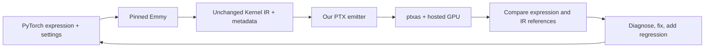

# Compiler presentation walkthrough

**Read only the block quotes in Part 1 aloud.** Screen directions, code links and Part 2 are preparation/reference material. Explain the ideas in your own words rather than reading unfamiliar code verbatim.

Implementation checkpoint: **60cad9e**. This presentation adds documentation and an MVP audit, without changing the compiler. The audit ran the exact eight required problems through the organizer's unchanged `submit.py --compiler compile.py`: **8/8 passed**. [Audit report](../../review/presentation/mvp-validation.json).

## Part 1 — speaker script

### Workflow: start simple, then grow real coverage

**Screen:** show the workflow below, then one generated fixture's expression.py, IR and emmy-proof.json.

> We built a direct compiler from Emmy Kernel IR to PTX. We started with the simplest pointwise add, then added loads, arithmetic, stores and reductions. After the baseline worked, we expanded the tests at the PyTorch level: changing expressions, sizes, datatypes and scheduling settings before compiling them with pinned Emmy.
>
> Every generated test keeps Emmy's IR unchanged and has an independent NumPy expected result. A second NumPy interpreter checks what the typed IR actually specifies. Our feedback loop is: generate, emit PTX, assemble, run on the hosted GPU, compare both references, then fix and add a regression. This separates compiler errors from upstream precision choices.

**Code to point at:** [fixture packaging/provenance](../../tools/emmy_fixtures.py), [generated operation cases](../../tools/test_operations.py), [independent interpreter](../../tools/ir_reference.py).



### High-level PTX generation

**Screen:** open the four functions linked here; do not scroll through the entire file.

> The compiler uses Emmy's existing parser to reconstruct typed nodes. It reads sibling metadata for argument order and launch information, then emits PTX directly. There is no CUDA translation step or additional intermediate representation.
>
> In compile.py, load_kernel loads the program, compile emits the entry and thread coordinates, and statement dispatches each node. The emitter tracks value bindings, datatypes, pointers and fresh virtual registers. PTX declares those registers, and ptxas performs physical register allocation. We preserve the supplied schedule and typed operation boundaries.

**Code:** [load_kernel](../../compile.py#L40), [compile](../../compile.py#L778), [statement dispatch](../../compile.py#L621), [Tile coordinates](../../compile.py#L405).

### Category 1: pointwise, extended beyond add

**Screen:** p00's actual IR, then arithmetic and vector_store. Optionally show the short PTX demo in Part 2.

> For pointwise work, an add becomes typed loads, add and a store. We extended that baseline to composed arithmetic, five numeric datatypes and conversions, plus boolean comparisons and where selection. Conditions use predicate registers, while selected values retain their numeric type.
>
> We also simplified Tile-coordinate arithmetic and grouped aligned stores into vector instructions, with a scalar fallback. Half values are rounded at operation boundaries, while double and wide integer data keep their width.

**Example:** `torch.relu(x) * y`, then `torch.where(x > y, x, y)`.

**Code:** [arithmetic](../../compile.py#L247), [conversions](../../compile.py#L147), [where/comparisons](../../compile.py#L182), [vector_store](../../compile.py#L352).

### Category 2 and fused kernels: reductions and normalization

**Screen:** r04's IR; show its loop, shuffle and shared-memory tree. Briefly show the public RMSNorm or softmax expression.

> Reductions need coordination. We translate Emmy's strided loops into per-thread partial sums, then preserve warp shuffles, shared-memory exchanges and barriers. We also added ordinary sequential Loop support, which Emmy emits for expressions such as two row sums added together.
>
> The same machinery supports the public RMSNorm, L2 normalization and row softmax programs. We follow the actual accumulator identity, datatype and merge instructions, including softmax's coupled state updates. Extended tests vary row widths and cooperative sizes rather than only repeating the public shapes. We preserve reduction order instead of inventing a different algorithm.

**Code:** [counted_loop](../../compile.py#L524), [merge_states](../../compile.py#L489), [tree_halve](../../compile.py#L569), [WarpShuffle emission](../../compile.py#L749).

### Math operations: an example of the feedback loop

**Screen:** the activation helper and the saved accuracy results; no need to explain polynomial coefficients.

> For math operations, we use native PTX instructions where accuracy permits. Float exp and log use hardware base-two instructions with corrections. Sigmoid uses a stable exp-based formula. Native tanh passed our half tests, but failed strict float tests, so float tanh uses a more accurate exp-based formula with a small-input correction. Double math stays double. We changed the implementation, not the test tolerances.

**Code:** [arithmetic dispatch](../../compile.py#L247), [native exp/log](../../ptx_math.py#L63), [activation](../../ptx_math.py#L11). [Accuracy explanation](15-sigmoid-and-tanh.md).

### Category 3: matmul, tensor cores and asynchronous copies

**Screen:** show the real staged f16 matmul IR beside its emitted PTX; highlight cp.async, ldmatrix and mma.sync.

> For matmul, we first generated real Emmy tensor-core schedules. We added register fragments, per-lane operand loads, native mma.sync, and guarded output stores. Our tests cover K tails, output edges, multiple warps, transposed operands and split-K chaining.
>
> We then added native asynchronous global-to-shared copies, commit and wait groups, swizzled shared layouts and ldmatrix loads. We preserve double and triple buffering from the IR. The public 512-by-512 matmul also needed an aligned dynamic shared arena using its existing metadata budget; it now passes. That public kernel uses scalar arithmetic, while our separate generated f16 examples demonstrate actual tensor-core instructions.

**Code in compile.py:** [statement dispatch](../../compile.py#L621), [shared allocation](../../compile.py#L720).

**Helper code:** [cp_async_copy](../../ptx_tensor.py#L38), [staged_matrix_load](../../ptx_tensor.py#L53), [mma_sync](../../ptx_tensor.py#L162), [reg_store](../../ptx_tensor.py#L172).

### Evidence, limits and future work

**Screen:** the coverage table and final MVP audit.

> All eight MVP problems pass through the organizer's compiler-testing path. Our latest checkpoint also passes 47 local tests and the additional generated matmul checks. We retain precision differences and unsupported cases in the reports, and we cannot claim hidden-set coverage.
>
> Next are atomic accumulation for the remaining public matmul, arrayed fragment families, fused tensor-core epilogues and attention. Beyond that, we would expand datatype coverage and use profiling to guide further optimization. The submission includes source, reproducible examples and documented limits.

---

## Part 2 — preparation and reference appendix, not spoken

### A. What the workflow actually does

1. **Naive baseline:** start with the supplied add/reduction examples and implement their actual typed statement kinds. Never identify a problem by name inside the compiler or hardcode its output.
2. **Generate extensions at the source level:** write PyTorch expressions and change shapes, datatypes and Emmy schedule knobs before tracing. Examples include width 1, irregular widths 33/129, different cooperative sizes, boolean compositions and matmul K tails.
3. **Pin the producer:** Emmy 0.3.11 emits the IR. `emmy_fixtures.py` compares the packaged payload with the original dump, allowing only the organizer's entry-name normalization, and writes a provenance/hash proof. No body/type/shape/schedule rewriting is permitted.
4. **Keep two references:** independent NumPy expression expectations, plus a bounded NumPy interpreter of the supplied typed IR. A GPU/IR match does not erase an original-expression failure.
5. **Compile and run our output:** `compile.py` emits PTX; local ptxas checks assembly; the hosted runner checks actual GPU output using the original metadata. Only our compiler's PTX is uploaded.
6. **Diagnose before optimizing:** distinguish producer rejection, unsupported compiler nodes, assembly failure, execution failure, expression mismatch and IR-reference mismatch. Fix the relevant layer and retain regression evidence.
7. **Inspect and measure:** examine PTX/SASS, physical register counts and spills. Benchmark only after correctness, keep paired samples, and distinguish historical measurements from the frozen implementation.
8. **Commit validated increments:** source, genuine examples, results and explanations are checked into the compiler repository. The current implementation is frozen while preparing the presentation.

If pinned Emmy cannot generate a particular source/schedule, that attempted case is out of scope. Trying a valid alternative PyTorch spelling or correcting a schedule knob is allowed; manufacturing replacement IR is not. Earlier synthetic fixtures are retired and excluded from active coverage totals.

### B. MVP and public-problem coverage

The MVP is **exactly the eight pointwise/reduction problems listed in MVP.md**, not all public categories and not every possible hidden variation.

| Category | Required/public problems | Verified status | Extension beyond the base case |
| --- | --- | --- | --- |
| 1 — pointwise, MVP | p00_scalar_add, p01_vector_add, p02_scale_shift, p03_relu_mul | **4/4 PASS**, fresh unchanged submit.py audit | Additional operations, five dtypes, conversions, comparison/where, irregular sizes, aligned grouped stores |
| 2 — reductions, MVP | r01_array_sum, r02_big_sum, r03_mean, r04_row_sum | **4/4 PASS**, same audit | Row/width/cooperative variations, ordinary Loop, composed reductions and normalization |
| 3 — public matmul | m01_matmul_512 | **PASS** against original expectation | cp.async pipeline, metadata-driven 73,728-byte dynamic arena; separate generated native-MMA examples |
| 3 — remaining public matmul | m02_matmul_rect | **Unsupported: atomic output writes** | Explicit future work; not included in passing counts |
| 4 — fused | f01_rmsnorm, f02_row_softmax, f03_l2norm | **3/3 PASS** in current public regression report | Typed math and coupled reduction state; additional generated normalization cases |
| 5 — attention-like | a01_attention, a02_attention_128 | **No end-to-end support claimed** | Future work; do not present these as passing |

Evidence: [fresh 8-case MVP audit](../../review/presentation/mvp-validation.json), [official-harness logs](../../review/presentation/mvp-logs), [11-case public regression](../../review/native-math/async-regression.json), [public m01 report](../../review/shared-matmul/public-validation.json).

This establishes the complete **open MVP** and 12 verified public problems across those reports. It does not establish hidden-set completeness. The large public m01 was checked against its original NumPy expectation; a full typed-IR interpretation was not run by default.

Latest feature checkpoint: 47 passing local test methods; 9 global-matmul cases and 9 shared-matmul cases passing both references. Historical suites include additional expression-level f64 precision differences caused by explicitly narrower operations in the producer's IR; those remain visible and are not counted as competition passes. Do not add overlapping/historical suite totals into a new unique-case coverage claim.

### C. Feature inventory and source map

| Feature | Implementation and scope | Where to inspect |
| --- | --- | --- |
| Submission contract | Parse typed Emmy JSON; sibling metadata supplies entry/argument/launch information; stdout contains PTX | [load_kernel](../../compile.py#L40), [main](../../compile.py#L844) |
| Launch and indexing | Decode flattened 1-D launches into static Tile coordinates; preserve given cooperative blocks; integer index arithmetic/comparisons/ternaries | [tile_coordinates](../../compile.py#L405), [index_expr](../../compile.py#L421), [predicate](../../compile.py#L446) |
| Numeric datatypes | f16/f32/f64/i32/i64 paths; 25 source-generated conversion pairs; half boundary rounding; full-width double/integer handling | [convert](../../compile.py#L147), [round_half](../../compile.py#L414), [datatype guide](03-datatypes-and-registers.md) |
| Memory and constants | Typed global/shared loads and stores; byte addresses from element indices; constants remain metadata arguments | [address](../../compile.py#L457), [memory_load](../../compile.py#L315), [memory_store](../../compile.py#L325) |
| Grouped stores | Two/four adjacent values, at most 16 bytes, only with proven alignment; scalar fallback otherwise | [vector_store](../../compile.py#L352), [optimization guide](09-optimizations.md) |
| Basic arithmetic | Add/subtract/multiply/divide, copy, ReLU, negation/abs, square, extrema, sqrt/reciprocal/rsqrt; operation-specific integer domains | [arithmetic](../../compile.py#L247), [full operation table](05-arithmetic.md) |
| Integer arithmetic | Width-preserving arithmetic, bitwise AND, signed right shift and power for nonnegative exponents | [arithmetic](../../compile.py#L247), [integer_power](../../ptx_math.py#L122) |
| Floating math | Native-backed f16/f32 exp/log, full-double math, variable power, stable sigmoid and precision-dependent tanh | [ptx_math.py](../../ptx_math.py), [native math](13-native-exp-log-and-coverage.md), [activations](15-sigmoid-and-tanh.md) |
| Boolean selection | Six numeric comparisons; internal predicates; tested AND/OR/NOT compositions and numeric where; no boolean memory ABI | [comparison](../../compile.py#L182), [boolean_assign](../../compile.py#L209), [where guide](14-boolean-comparisons-and-where.md) |
| Control flow and state | Cond, ordinary Loop, StridedLoop, typed Init/Let; loop-local bindings and accumulator state | [counted_loop](../../compile.py#L524), [statement](../../compile.py#L621), [control-flow guide](06-control-flow.md) |
| Reduction machinery | Accumulators, actual identity/base/merge programs, warp shuffles, shared trees and barriers; generated sum/mean/max and fused examples | [merge_states](../../compile.py#L489), [tree_halve](../../compile.py#L569), [WarpShuffle](../../compile.py#L749) |
| Fused normalization | Public weighted RMSNorm, L2 normalization and online row-softmax programs | [normalization guide](08-normalization.md), [operation expansion](11-operation-expansion.md) |
| Native tensor cores | Single m16n8k16 f16 A/B, f32 C fragments; global/staged transport, K zero-fill, output guards, transposed B and split-K intermediates | [dispatch](../../compile.py#L621), [ptx_tensor.py](../../ptx_tensor.py), [tensor-core guide](16-first-tensor-core-matmul.md) |
| Native copy engine | cp.async issue/commit/wait, generated single/double/triple buffers, staged ldmatrix; tested B32/B64/B128 layouts | [cp_async_copy](../../ptx_tensor.py#L38), [staged_matrix_load](../../ptx_tensor.py#L53), [shared guide](17-shared-memory-async-copies.md) |
| Shared allocation | Static storage or aligned slices of a dynamic arena, bounded by the unchanged metadata budget | [Smem dispatch](../../compile.py#L720), [compile](../../compile.py#L778) |
| Independent verification | NumPy expression oracles, typed-IR interpreter, per-lane copy-group model and numerical warp-MMA model | [ir_reference.py](../../tools/ir_reference.py), [tensor_reference.py](../../tools/tensor_reference.py), [fixture proof](../../tools/emmy_fixtures.py) |

**Handler-only capabilities are not end-to-end coverage claims.** Product/minimum reduction combiners, direct exp2/log2/log10 names, bitcast, extra boolean aliases, 4/8-byte async copies and swizzle shift overrides have handlers or partial checks, but are not all represented by fresh successful source-generated GPU cases. The pinned producer rejects some direct operations. Use the individual guides/reports rather than saying every operator/type combination is covered.

**Implemented optimizations:** constant/power-of-two Tile-coordinate simplifications, alignment-proven grouped stores, native-backed scalar math and the IR's native tensor/copy instructions. We do not implement liveness analysis, physical register allocation, general loop-invariant motion, arbitrary multiply/add contraction, schedule retuning or reduction reassociation. ptxas assigns physical registers.

### D. Commands to prepare and demonstrate

Run these commands **inside Ubuntu WSL**. For the existing workspace:

```bash
cd /mnt/c/Users/12066/Documents/Codex/2026-10-21/im-wo/work/emmy-hackathon-2026
source /tmp/emmy-extended-env/bin/activate
```

For a fresh checkout, use Python 3.12+ and install `emmy-ml==0.3.11 numpy requests` in a virtual environment. Compilation itself needs no local GPU or nvcc. Regenerating fixtures additionally needs CPU PyTorch matching the fixture provenance; local assembly tests need ptxas, and disassembly needs cuobjdump. Reuse the configured environment for the recording rather than reinstalling packages today.

**Short pointwise demo:**

```bash
mkdir -p review/presentation/demo
python compile.py problems/p00_scalar_add/k_add_pointwise.ir.json --inspect
python compile.py problems/p00_scalar_add/k_add_pointwise.ir.json > review/presentation/demo/p00.ours.ptx
grep -E 'ld.global|add.rn.f32|st.global' review/presentation/demo/p00.ours.ptx
python submit.py p00_scalar_add --compiler compile.py
```

**Short native-copy/tensor-core demo:** the glob below selects the single generated kernel in this saved fixture.

```bash
python compile.py tests/matmul/matmul_mma_shared_f16_16x8x16/*.ir.json > review/presentation/demo/shared.ours.ptx
grep -E 'cp.async|ldmatrix|mma.sync' review/presentation/demo/shared.ours.ptx
python tools/test_matmul.py --suite shared --only matmul_mma_shared_f16_16x8x16 --reuse --runner --report-name presentation-shared-demo.json
```

**Complete MVP check:**

```bash
python tools/test_mvp.py
```

This calls unchanged `submit.py <problem> --compiler compile.py` for all eight required cases. It saves per-case logs and source hashes in review/presentation. It tests the compiler, not canned PTX. These hosted checks are not the final event submission.

**Additional reproducible feature checks — prepare these before recording, not all during the video:**

| What to run | Ubuntu command |
| --- | --- |
| Local regression suite | `python -m unittest discover -s tests -p 'test_*.py'` |
| Datatype conversions and math ranges | `python tools/test_pytorch_cases.py --runner` |
| Pointwise/reduction combinations, fresh f32 cases | `python tools/test_operations.py --dtypes f32 --sizes 33 129 --runner` |
| Normalization extensions plus public cases | `python tools/validate_normalization.py --generate --runner` |
| Sequential-loop compositions | `python tools/test_serial_loops.py --reuse --runner` |
| Comparisons, boolean logic and where | `python tools/test_where.py --reuse --runner` |
| Sigmoid/tanh and compositions | `python tools/test_activations.py --reuse --runner` |
| Global-memory tensor-core examples | `python tools/test_matmul.py --reuse --runner` |
| Shared copies, swizzles and pipelining | `python tools/test_matmul.py --suite shared --runner` |
| Public 512×512 matmul | `python tools/test_public_matmul.py --runner` |

The activation command retains one f64 expression-level reduction difference and therefore exits nonzero; its GPU/IR checks pass. The shared generator records one upstream-rejected shape/schedule separately from nine passes. Strict --reuse requires provenance, so regenerate older fixtures without proofs instead of inventing a proof. The global and shared test tools upload only our PTX. The public m01 tool checks its original expectation by default; --ir-reference adds a slower full-schedule interpretation.

The earlier native-math benchmark is in [timings.json](../../review/native-math/timings.json). Its paired measurements belong to the recorded source hashes and unlocked GPU clocks. Do not present those ratios as a benchmark of every current kernel or rerun its baseline guard blindly against this later compiler revision.

### E. Future work and honest limits

1. Add and validate atomic output accumulation for public m02, preserving its zero_outputs and split-K behavior.
2. Support arrayed register-fragment families and dynamic family references generated by larger output tiles.
3. Add fused fragment epilogues and end-to-end attention coverage.
4. Broaden producer-generated datatype/layout/shape coverage; investigate additional MMA forms and copy engines where both producer and target support them.
5. Profile stable cases, then improve addressing/data movement and compare performance with controlled measurements.

Currently unsupported or unproven: full attention, atomic stores, arrayed fragments, general stateful array Loops, arbitrary branch joins, boolean memory/output ABI, additional MMA dtypes/shapes, TMA/WGMMA, general multidimensional launches and dynamic shapes. Numerical sampling does not prove universal math error bounds. Hidden tests remain unavailable.

### F. Recording and submission checklist

- [ ] Rehearse only Part 1; keep the recording between 3 and 5 minutes in your own voice.
- [ ] Pre-open compile.py, p00/r04 IR, the staged tensor-core IR/PTX and the MVP result. Explain selected functions rather than scrolling through the whole source.
- [ ] Include compile.py, ptx_math.py and ptx_tensor.py at the repository root; verify the exact compiler command from a clean environment.
- [ ] Keep the fresh 8/8 MVP report, examples and feature guide in the submitted source tree. Label unsupported features and precision differences honestly.
- [ ] **Repository visibility:** our working GitHub repository is currently private. The organizer's README requires a public repository. Resolve that before submitting; this documentation work does not change repository visibility.
- [ ] Make the video accessible to anyone with its link. Confirm the cutoff and submission requirements in the organizer's [README](../../README.md) and [submission portal](https://riftstack.ai/hackathon/submit).
- [ ] Submit the repository URL and video URL through the event form with a time buffer. Running submit.py is a GPU test, not that final submission.

**If asked why the reference files changed:** they are our independent NumPy checker, not Emmy IR. We extended their semantics for new instructions and fixed checker state handling. We did not rewrite the supplied IR or replace original expectations with interpreter output.

**If asked why some operations still need math sequences:** PTX has useful hardware instructions, but not a correctly rounded native instruction for every operation/datatype. Native tanh was insufficient for our strict f32 samples; f64 must not silently narrow. The emission follows the declared datatype and validated accuracy path.
