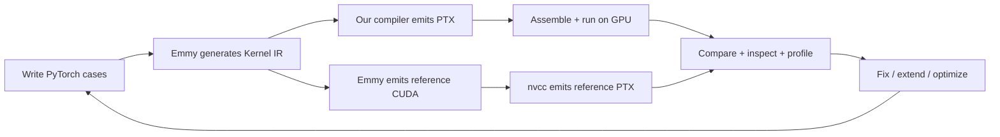
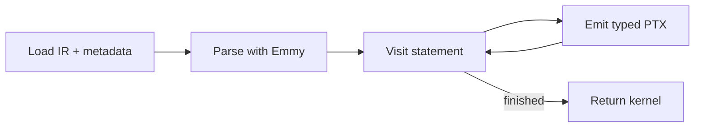

# Compiler walkthrough

## 1. Our development workflow

Start with a naive compiler for the public cases, then **generate more cases to expose missing features, bugs and optimization opportunities**.



Vary operations, sizes, datatypes and schedules **before tracing through pinned Emmy**. Use its unchanged IR; compare GPU output with independent NumPy results and a typed-IR interpreter.

Locally compare **our PTX against Emmy CUDA → nvcc PTX**, then assemble both to inspect SASS, registers and spills. This revealed redundant coordinate math and scalar stores. Only our compiler's PTX goes to the hosted GPU; static differences guide experiments, not speedup claims.

| What the test reveals | Our next step |
| --- | --- |
| Unsupported generated IR | Add the missing PTX emission feature |
| Assembly failure or output mismatch | Trace IR → PTX, isolate the bug and retain a regression case |
| Correct output with inefficient PTX/SASS | Optimize, rerun correctness checks and benchmark |

Examples: strict f32 tanh failures led to a math fix without relaxing tolerance; grouped writes led to aligned vector stores. New cases exercise each change and repeat the loop.

## 2. How the compiler runs

Our compiler translates **scheduled Emmy Kernel IR directly into PTX**, preserving datatypes and launch metadata.



`statement()` dispatches operations and recursively visits loop bodies. Python generates instructions; the GPU executes them later. **ptxas allocates physical registers.**

Code: [load_kernel](../../compile.py#L40) → [compile](../../compile.py#L778) → [statement](../../compile.py#L621).

## 3. Features: PyTorch → IR → PTX

### Pointwise: two elements per worker

```python
result = torch.randn(128) + torch.randn(128)
```

| Actual IR excerpt | Corresponding PTX excerpt |
| --- | --- |
| `f32 v0__u0 = add(in0__u0, in1__u0)` | `add.rn.f32 %f3, %f1, %f2;` |
| `add[((a0 * 2) + 0)] = (v0__u0, v0__u1)` | `st.global.v2.f32 [%rd16], {%f3, %f6};` |

The `N=64` tile covers 128 elements. Each worker computes two adds, then writes both together when alignment permits. Loads, guards and the second add are omitted above.

**Beyond the baseline:** f16/f32/f64/i32/i64, conversions, composed arithmetic, comparisons and `where`.

Code: [arithmetic](../../compile.py#L247), [vector_store](../../compile.py#L352).

### Reductions: partial sums → one result

```python
result = torch.randn(64, 512).sum(-1)
```

| Generated IR | PTX mapping |
| --- | --- |
| `for a1 in a1_co..512:128` | Compare/branch/increment: per-thread partials |
| `WarpShuffle(acc0, length=32)` | `shfl.sync.bfly.b32` + add: warp sums |
| `Sync` + `TreeHalve` | `bar.sync` + shared-memory tree: final sum |

**Beyond sum:** sequential loops, varied reduction widths, RMSNorm, L2 normalization and online softmax. Accumulator types, identities and coupled-state merges remain explicit.

Code: [counted_loop](../../compile.py#L524), [merge_states](../../compile.py#L489).

### Tensor cores and asynchronous copies

```python
a = torch.randn(16, 16, dtype=torch.float16)
b = torch.randn(16, 8, dtype=torch.float16)
result = a @ b
```

| Generated IR node | Native PTX mapping |
| --- | --- |
| `CpAsyncCopy`, commit/wait | `cp.async` + completion groups: stage into shared memory |
| `LdmatrixLoad` | `ldmatrix.sync.aligned`: load warp fragments |
| `MmaSyncPtx` | `mma.sync.aligned.m16n8k16.row.col.f32.f16.f16.f32` |

**Beyond basic matmul:** guarded edges, split-K, transposed B, multiple warps, swizzles and double/triple buffering. The public scalar matmul also supports dynamic shared memory.

Code: [tensor emission](../../ptx_tensor.py).

## 4. Verified coverage

**MVP: 8/8 · Local tests: 47 · Generated matmul: 9 global + 9 shared**, passing both references. Public fused examples and 512×512 scalar matmul also pass. Hidden coverage remains unproven.

```bash
python tools/test_mvp.py
python tools/test_matmul.py --suite shared --runner
```

## 5. Future work

Atomic accumulation for m02; arrayed fragments and fused tensor-core epilogues; end-to-end attention; broader datatypes and profiling-led optimization.
